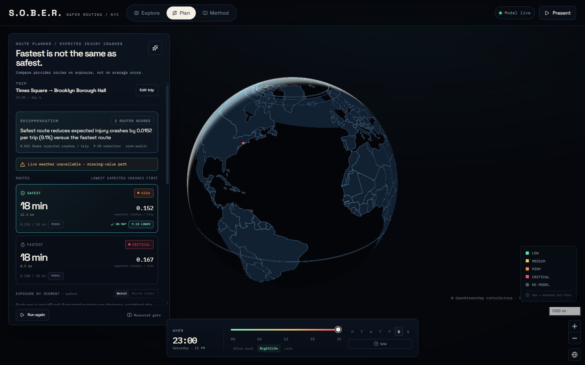

# S.O.B.E.R. - safer routing demo

S.O.B.E.R. is a New York City crash-risk surface and route planner. This folder is
the judged demo build: a rebuilt React frontend in `app-v2/` talking to the validated
Flask + model backend in `API/MAPS/`.

The demo answers one question: **is the fastest route the safest route?** It scores
every H3 res-8 cell-hour in NYC, compares real routes on expected injury-or-fatal
crashes, and explains the worst segment. Everywhere else it gives a **clearly labelled
global estimate** (country road-death rate, road, turns, hour, live weather and
nightlife) instead of pretending the NYC model knows London or Riyadh.



## Run it

```powershell
# 1. backend - port 5000 (Python 3.12)
cd API/MAPS
pip install -r requirements.txt
python -u app.py

# 2. frontend - second terminal, port 5173 (Node 22)
cd app-v2
npm install
npm run dev
```

Open **http://localhost:5173**. On Windows PowerShell with a strict execution
policy, use the `.cmd` shims (`npm.cmd`, `npx.cmd`).

### Explore any place

The Explore tab scores whatever place you choose: search a street, place or city,
tap a shortcut, or click anywhere on the map. Hover a hex to read its neighbourhood
and score. The shortcuts come in three rows, labelled by what scores them: **NYC**
(seven neighbourhoods, the NYC crash model), **UAE** (Downtown Dubai, Dubai Marina,
Deira, Abu Dhabi Corniche, Sharjah's Al Wahda Street, Al Ain: the global crash
model) and **World** (London, Paris, Tokyo: the global estimate). The panel names
the place, breaks the score into crash model and nightlife, shows the 24-hour trend,
the crash clusters within 2 km (NYC), safe stops, weather alerts when there are any,
and can plan a route from there. Each fact is shown once.

The Vite dev server and the production preview both proxy `/api` and `/geocode` to
`http://127.0.0.1:5000`, so the browser only sees one origin. (Place search used to
go straight to Nominatim; when Nominatim was unreachable a search hung for 21 s.)
Production preview:

```powershell
npm.cmd run build
npm.cmd run preview   # http://localhost:4173
```

## Demo script

Open the demo URL below in a **fresh tab** and let the globe intro finish. The route
is Times Square to Brooklyn Borough Hall, Saturday at 23:00.

```text
http://localhost:5173/plan?olat=40.75800&olon=-73.98550&oname=Times+Square&odetail=Manhattan%2C+New+York&dlat=40.69280&dlon=-73.99010&dname=Brooklyn+Borough+Hall&ddetail=Downtown+Brooklyn%2C+New+York&lat=40.75800&lon=-73.98550&hour=23&day=5&scenario=saturday-night&run=1
```

| # | Beat | What the audience sees |
|---|---|---|
| 1 | Live risk surface | Explore at Times Square: CRITICAL 100, model 60/60 (99.7th percentile), nightlife 40/40 (145 venues within 1 km). Every one of the 1,122 model cells is on the map, coloured for this hour. |
| 2 | Load the scenario | Plan with Times Square -> Brooklyn Borough Hall, 23:00. |
| 3 | Fastest vs safest | Five routes scored. Safest 0.108 vs fastest 0.168 expected crashes; **36.0% lower**; 22.5 vs 18.0 min. |
| 4 | Explain the worst segment | 9th Avenue, km 0.1-1.3 of the safest route: 99.4th percentile, model 60/60, nightlife 40/40, H3 `882a10725bfffff`. |
| 5 | Change the hour | 03:00: safest 0.072 vs fastest 0.113 (**36.1% lower**), both a third below 23:00. The surface is time-aware. |
| 6 | Show the measured gate | Method: 0.0359 vs 0.0459 temporal deviance; 0.0548 vs 0.0557 Brooklyn holdout; 1,122 cells. |
| 7 | Be honest outside NYC | Newark: "Outside model coverage", crash model 0/60, rate `-`, no crash points. |
| 8 | Beyond New York: the UAE | Downtown Dubai, "Global crash model": dense hexes around the point, the percentile among every UAE place and hour, and one line saying it never saw UAE crash records. |

Other countries: the sparkle button in the Plan panel steps through eight demo trips
(New York; Dubai, the Sharjah to Business Bay morning commute and Abu Dhabi to Yas
Island; London, Paris, Riyadh, Tokyo), and the empty planner has a chip for each.
New York is scored by the NYC crash model, the UAE trips by the global crash model,
the rest by the global estimate.

Click **Present** to run these eight beats with the arrow keys. `ArrowRight` /
`ArrowLeft` move, `Escape` exits. The Present bar names the beat and keeps the
camera on the thing being discussed.

The 03:00 URL is the same URL with `hour=3`.

The numbers above were measured on 2026-11-03. They move with the calendar and
the weather: the model takes the month and holidays from the server's date and
reads live weather, and the route provider can return different alternatives.
Re-run the two URLs before the demo and read the numbers off the screen.

### Pre-flight for the judged run

- **Pre-warm both routes.** The route providers are live (OSRM public first). The
  backend keeps route responses in an in-memory cache for **300 seconds**. Open the
  23:00 URL once and the 03:00 URL once, confirm both values, then start the demo
  within five minutes. Do not restart the backend after warming it.
- **Use a fresh tab.** A tab that has been clicked and navigated many times can keep
  a stale map point or panel. Close it and open the demo URL again. If the panel and
  the URL disagree, that is the symptom; a fresh tab fixes it.
- **Weather is live without a key.** Open-Meteo answers first and MET Norway backs
  it up; `WEATHER_API_KEY` (WeatherAPI.com) is only an optional first choice. The
  status popover names the provider that served the last reading.
- The basemap and globe are local files. The route provider is the only live
  dependency the route itself cannot do without; if it fails, the UI shows the error
  rather than inventing a route. Everything else degrades: see "Live providers".

## What is in the box

```text
S.O.B.E.R NEW DEMO/
  app-v2/               rebuilt frontend (Vite 8 + React 19 + TypeScript 6)
    src/                23 source files, 6,805 lines
    public/basemap/     local NYC PMTiles extract
    public/geo/         local 110m world GeoJSON for the globe
    scripts/            validate-contract.ts (106-line API contract gate)
    REPORT.md           detailed build report
  API/MAPS/             Flask API, model artifacts, SQLite demo DB
  docs/screenshots/     the verified screenshots used in this README
  issues/               local issue files 0001-0010
  PRD.md                the approved product requirements
```

The folder is a git repository. Local databases (`*.db`), logs, builds,
`node_modules` and any `.env` file are ignored; copy `API/MAPS/.env.example` to
`.env` for local settings. No API key is needed to run the demo.

## Stack

| Layer | Choice |
|---|---|
| Build | Vite 8.3.5 |
| UI | React 19.3.1, TypeScript 6.0.3 (`strict`, `noUncheckedIndexedAccess`) |
| Styling | Tailwind CSS 4.3.3, Radix primitives, shadcn-style components |
| Map | MapLibre GL 6.15 (direct, no react-map-gl wrapper), PMTiles 4.5, h3-js 4.5 |
| Routing | React Router 7.18.5 |
| Data | TanStack Query 5.105, Zod 4.6.7 |
| Motion | Motion 12.43 |
| Backend | Flask, SQLite, scikit-learn boosted Poisson, pandas/numpy |
| Tests | pytest (backend), a TypeScript contract gate, manual Playwright checks |

The rebuilt UI uses MapLibre. The earlier Leaflet packages are still listed in
`app-v2/package.json` from the prototype but are not imported.

## The model

The model is a boosted Poisson regressor (`poisson_base`) over H3 res-8 cells. The
artifact metadata's `target` string says per km2-hour, but the serving code treats
`model.predict(x)` as expected crashes per H3 cell-hour and derives the per-km2-hour
area rate by dividing by cell area. The UI and route math use the cell-hour value;
the metadata string is stale. Property-damage-only crashes are excluded.

| Field | Value |
|---|---|
| Artifact version | `2026.11.03-1`, status `approved` (retrained on the repaired data) |
| Model surface | 1,122 H3 res-8 cells in NYC |
| Training window | 2020-01-01 to 2026-06-11 |
| Crashes | 226,745 injury-or-fatal crashes |
| Gate | passed 2026-11-03 |
| Temporal test | deviance **0.035891** vs EB baseline **0.045884** (21.8% lower) |
| Brooklyn holdout | deviance **0.054842** vs EB baseline **0.055654** (1.5% lower) |
| Top-decile lift | **3.90x** temporal / **2.19x** Brooklyn; baseline 2.92x / 1.71x |
| Deciles | monotonic on both tests |
| Temporal MAE | 0.007023 vs baseline 0.007934 |
| Holdout MAE | 0.008387 vs baseline 0.008266 (slightly worse; disclosed) |

The Method screen reads these numbers from `/model_card`, which serves the loaded
artifact's metadata, so a retrain cannot leave the page quoting the previous model.
The previous artifact (`2026.10.29-1`, 192,219 crashes) was trained on the
misaligned download described under "Data repair"; on the same cells the new model's
ranking agrees with it (Spearman 0.995), its rates are 5-23% higher on average
depending on the hour, and about a third higher in the 50 busiest cells.

Features: leakage-safe historical rate (prior years only), 2020 census housing
density per NTA, H3 centroid, borough, hour/weekday/month/weekend/holiday, COVID era,
and optional weather (temperature, rain, wind; `NaN` when missing). Housing density
is the external, non-crash covariate that makes the Brooklyn holdout transfer work.

The score is **0-100**: model 0-60 from percentile tiers (below P50 0, P50-P75 15,
P75-P90 30, P90-P99 50, at/above P99 60) plus nightlife 0-40 (0 bars 0; 1-5 bars 8;
6-13 bars 16; 14-50 bars 28; more than 50 bars 40). Bands: LOW below 25, MEDIUM
25-49, HIGH 50-74, CRITICAL 75 and above.

Route exposure is distance-linear: `rate * segment_km / sqrt(cell_area_km2)`. The
per-10-km figure is derived from the total and the route length. Duration only
labels the fastest/balanced routes. The recommendation picks the **lowest total
expected injury crashes**, not the lowest 0-100 average.

## API surface

The backend exposes **22 routes** and the UI surfaces every one of them. `/health`
reads its list from the router, so it always matches what is served.

| Route | Where it shows up | Purpose |
|---|---|---|
| `/health` | status chip popover (top bar); Method page | model/version/index/provider status, routing chain |
| `/risk` | Explore panel | cell-hour score, percentile, rate, band, signals, a `place` name (neighbourhood, or road and country) and `danger_types` (what kind of crash is over-represented here now; route segments carry a compact form) |
| `/surface` | map hexes (New York) | every one of the 1,122 model cells for an hour, with neighbourhood names; one batched prediction (~150 ms, ~10 ms cached). `danger=impaired` (or `drowsy`, `speeding`, `failure_to_yield`) adds each cell's expected rate of that kind of crash: the Explore map layers |
| `/danger_types` | Method page, "07 / Danger types" | the danger-type model card: definitions, gate and 2026 held-out metrics |
| `/model_card` | Method page, headline metrics, "04 / Calibration" and "05 / Limits" | the crash model's own validation numbers (deviance, lift, deciles, cells, window), read from the loaded artifact |
| `/surface/global` | map hexes (the UAE) | the global crash model's hexes within `radius_km` (max 25) of a point, scored for an hour, with offline nightlife; 404 outside every region |
| `/global_model` | Method page, "08 / Global crash model" | the global crash model's card: training cities, protocol, mapping check, leave-one-city-out gate results |
| `/heatmap` | map hexes (outside New York) | the global estimate sampled on an 8 x 8 grid around a point |
| `/risk/trend` | Explore "risk by hour" strip | risk by hour |
| `/risk/compare` | Explore "Compare two places" | side-by-side comparison of a picked place A and B |
| `/safe_route` | Plan panel and map | up to five routes scored on expected crashes (see below) |
| `/safe_route?live=1` or `&date=YYYY-MM-DD` | Plan | the same answer with traffic: every route timed by TomTom on its exact road, plus TomTom's own traffic-aware roads scored for risk like any other. Adds a `traffic` block, and `recommended_route` becomes the fastest unless a slower road cuts risk by at least 5%, buys at least 1% per extra minute and adds at most 30% to the time. All routes are timed or none. Needs `TOMTOM_API_KEY`; without it, times assume empty roads and the app says so |
| `/safe_route/guidance` | Road simulation | English turn-by-turn directions from TomTom for one route of the trip, along the same road. `available: false` with a reason without a key; the drive still runs, without turns |
| `/tiles/satellite/{z}/{x}/{y}.jpg` | Map, Satellite button | satellite imagery from TomTom, through the API so the key stays on the server. Tiles are only fetched while the layer is on; 503 without a key |
| `/night_plan` | Plan, "Get home safe" | from 20:00 to 05:59, a plan for the whole trip: it scans every road, picks the same road as the recommendation, gives a reason for each one it turns down, then lists the drive turn by turn with each risky part flagged, plus a stop and a calmer pickup within a 1 km walk. Restates what is already scored; `{"applies": false}` by day |
| `/response_gap` | Explore, "If something goes wrong here" | the nearest mapped hospital to a place, and every scored place sorted by risk (75th percentile) and distance (5 km), with the worst gaps ranked, or the furthest high-risk places where there are none. New York and the UAE only. Distance is a straight line, not an ambulance time |
| `/safe_route/departures` | Plan "When to leave" | the chosen route scored at each hour, three either way, without routing again. Suggests a time only for a cut of at least 15% that also beats the citywide change at that hour, and never in the small hours (00:00-05:59); `from_hour` and `from_day` keep the window on the original plan after a suggestion is taken; answers `available: false` for a trip with no learned crash model |
| `/hotspots` | Explore "Crash clusters near here", dots on the map | historical crash clusters; with `lat`/`lon` the busiest within `radius` m (default 2 km), with distances |
| `/nearest_safe` | Explore "Nearby safe stops", drawn on the map | every safe stop in range, police and hospitals first |
| `/stats` | status chip popover, "Live usage" | aggregate request outcomes only |
| `/alerts` | bell icon (top bar) | the city-wide weather watch list |
| `/alerts/check_location` | Explore "Weather" card | alerts near the selected point |
| `/ml/stats` | Method page, "06 / Severity classifier" | the severity model's own validation numbers |
| `/ml/severity` | Explore "If a crash happened here" | what-if severity for a vehicle and cause (research only) |
| `/ml/confusion_matrix`, `/ml/feature_importance` | Method page figures | charts rendered by the API |
| `/geocode` | Plan origin/destination search | place search: Photon, then Nominatim, then an offline city list |

### How `/safe_route` finds alternatives

A routing provider volunteers one to three routes and, in a dense street grid, often
two. The planner adds more in two steps, all scored on the same model surface:

1. **Waypoint alternatives.** Up to eight waypoints are placed to either side of the
   fastest route (the two flanking its riskiest stretch first). Each is routed
   through OSRM (`origin -> waypoint -> destination`, no U-turn at the waypoint) in
   parallel and kept only if it differs from every route already found, is not
   absurdly longer, and does not drive out and back along the same road. The
   response reports what was tried and dropped in `via_alternatives`.
2. **Offset detours.** Only if the provider returned fewer than two routes *and* no
   waypoint alternative survived, the original synthesised detours run.

Routes are ranked by expected injury crashes per trip. Set `SOBER_VIA_ALTERNATIVES=0`
to turn the waypoint step off; it also stays off whenever the provider is replaced
by a test double.

Every JSON response carries `schema_version: "1.0.0"` through an `after_request`
hook. `/safe_route` and `/heatmap` are rate-limited to 60 requests/minute for the
demo. Inside NYC the crash model scores; an uncovered NYC cell (a river, a park)
stays `rule_based_only`. Outside NYC the answer is the global estimate below, with
`coverage: "context"` and `model_version: "context-2"`.

## What kind of crash: danger types

The score says how much risk; danger types say **what kind**. For a place and
hour inside the NYC model, `/risk` reports how often injury crashes there had
each kind of factor recorded, and the Explore tab shows it ("What kind of crash,
here and now"), with a map layer per kind:

| Kind | Recorded factors | Share of injury crashes | Served at | 2026 top-decile lift | Status |
|---|---|---|---|---|---|
| Impaired | alcohol, illegal drugs | 1.8% | neighbourhood x time | 3.10x | validated |
| Drowsy | fell asleep, fatigued | 0.56% | borough x time | 3.28x | validated |
| Speeding | unsafe speed | 5.0% | neighbourhood x time | 1.83x | validated |
| Failure to yield | failure to yield right of way | 12.5% | neighbourhood x time | 1.77x | validated |
| Distracted | inattention, phones, other distraction | 28.6% | - | 1.33x | **switched off** |

- **Target, not feature.** Contributing factors are recorded after a crash, so
  the crash model never sees them. Here they are what is estimated, from inputs
  known before a trip: the area (2020 neighbourhood or borough of the H3 cell)
  and one of six bands of the week.
- **Sparsity.** Shares are pooled and shrunk neighbourhood -> borough -> city
  (empirical Bayes, strengths tuned on 2025). Each kind's level was chosen on
  2025 and scored once on 2026 against a gate fixed before training: beat one
  citywide share, top-decile lift of at least 1.5x, and an area level must beat
  time-only. Distraction is recorded in 3 of 10 crashes everywhere, so place
  and time barely rank it (1.33x); it ships switched off.
- **One line per kind.** The number is its expected rate (crash-model rate x
  share) against a typical NYC cell-hour: how much of that kind of crash to
  expect here now. The tag ("more common here", "usual mix", "less common
  here") compares its share of local injury crashes with the city's **at the
  same time of week** (`band_share_ratio`), decided on the 80% interval, so it
  says something about the place that the number does not: impaired crashes are
  a bigger share everywhere on weekend nights, and at Times Square then they are
  about the usual share while speeding is less common. The share and interval
  open on tap. Neither changes the 0-100 score. An estimate with fewer than 5
  expected recorded crashes behind it shows "not enough data".
- Train: `cd API/MAPS/crash_model && python train_danger_types.py` (writes
  `danger_types.json`, about 300 KB). It uses the crash model's 226,745 injury
  crashes (train 175,036, validation 2025 36,453, test 2026 15,256); the 2026
  test holds only 61 drowsy crashes, so that lift is the least certain. Retrain
  it after the crash model, because the expected rates multiply the two.

**Data repair (2026-11-03).** `fetch_crashes_rich.py` used to append each
50,000-row page in the column order of that page's first record, and the API
leaves out empty fields, so 9 of 13 pages had values in the wrong columns
(vehicle types in the factor columns; in two pages longitudes in the latitude
column). The script now writes one fixed column order and refuses a misaligned
file. `nyc_crashes_rich.csv.gz` is now the re-downloaded file (638,003 crashes,
244,037 with an injury or death), and the crash model, the danger types and the
severity model were all retrained on it. The old file had lost about 15% of injury
crashes (rows whose coordinates landed outside the city) and fed the severity model
scrambled features.

## The UAE: the global crash model

New York's crash model knows New York. For the UAE, `API/MAPS/global_model/` trains a
second model on the crash records of six cities, Dubai among them, and serves it for
every UAE hex. The UI labels it "Global crash model" and says, once, what it learned
from.

| City | Source | Injury crashes 2021-2025 | Hexes |
|---|---|---|---|
| New York | NYC Open Data h9gi-nx95 (injured or killed > 0) | 180,880 | 1,100 |
| Chicago | City of Chicago 85ca-t3if (injuries_total > 0) | 84,833 | 856 |
| London | DfT STATS19 (Metropolitan and City of London police) | 111,341 | 2,296 |
| Paris | ONISR BAAC (departments 75, 92, 93, 94) | 59,216 | 1,121 |
| Berlin | Destatis Unfallatlas (state 11) | 61,547 | 1,128 |

- **Inputs exist everywhere.** OpenStreetMap road length by class and street
  junctions in each H3 res-8 hex and its six neighbours, Kontur population, and the
  hour and day of the week counted from the start of the local weekend (Saturday in
  the UAE since 2022).
- **Target.** Each city's crashes per hex-hour **relative to its own average**: cities
  count crashes differently, so the model ranks places and hours and never claims a
  crash count. A city's study area is the hexes its records cover (3+ crashes, plus
  the holes they surround).
- **Validation, fixed before training.** Leave one city out. The feature set was
  chosen with the other cities' 2021-2022 crashes scored on the held-out city's 2023;
  the gate trains on 2021-2023 and scores the held-out city's 2024-2025: a city the
  model never saw, in years after the ones it learned from.
- **Mapping check, fixed before the gate.** On the five cities the model does best
  with tagged features too (signals, crossings, bus stops, footways, places). Per
  street junction the UAE has far fewer of them mapped than the least-mapped training
  city (signals 0.10x, crossings 0.30x, bus stops 0.04x, bars 0.04x), so a model
  would read "not mapped" as "not there". The UAE is served with **`roads`**
  (population, road length by class, junctions), whose ratios in the UAE fall inside
  the training cities' range.

Original gate, on the five cities (passed; the six-city rerun is below):

| Held-out city | Crashes 2024-25 | Top-decile lift: time only / population / **roads** | Rank correlation per hex: population / **roads** | Top 10% of hexes hold |
|---|---|---|---|---|
| New York | 73,179 | 1.67x / 2.71x / **2.87x** | 0.78 / **0.84** | 22% of crashes |
| Chicago | 36,057 | 1.87x / 2.39x / **2.60x** | 0.63 / **0.71** | 19% of crashes |
| London | 41,851 | 2.13x / 3.39x / **3.79x** | 0.70 / **0.85** | 30% of crashes |
| Paris | 21,581 | 1.71x / 2.78x / **3.22x** | 0.63 / **0.76** | 25% of crashes |
| Berlin | 25,640 | 2.17x / 3.50x / **4.39x** | 0.61 / **0.84** | 34% of crashes |

Beats population-and-time in 5 of 5 held-out cities (Poisson deviance 5.2% lower on
average); mean top-decile lift 3.37x (lowest 2.60x); mean rank correlation per hex
0.80. For comparison, the tagged `mapped` set reaches 3.56x and 0.84 on the same split,
which is what the UAE gives up for robustness.

**Serving.** A UAE score is the percentile of a hex-hour among the hexes Dubai Police
record (1,552 of 33,989) at every hour of the week, the counterpart of New
York's all-urban reference, on the same 0-60 tiers. Ranked against every hex, most of
them desert, every city street sat in the top 2% at every hour. Nightlife (0-40) is
counted from the same OpenStreetMap extract, so a UAE answer never waits on a live
lookup; OSM tags few UAE bars (352 in the country, mostly inside hotels), so nightlife
points there are low. `/risk`, `/risk/trend`, `/risk/compare`, `/heatmap` and
`/safe_route` use the model for any point in the UAE table; `/surface/global` returns
the hexes around a point for the map (~700 within 14 km in 0.07 s); `/global_model`
is its model card (Method section 08). Elsewhere outside New York the global estimate
answers as before.

**Tested on Dubai, then trained on it.** Dubai Police's records came in two steps.

First, a clean test. `validate_dubai.py` repeats the gate's split: the five cities'
2021-2023 crashes train the model, Dubai's 2024-2025 records score it.

| Dubai target, 2024-2025 | Records | Top-decile lift: time only / population / **roads** | Rank correlation per hex: population / **roads** | Top 10% of hexes hold |
|---|---|---|---|---|
| Collisions rated serious or moderate (primary) | 17,844 | 1.43x / 1.89x / **2.88x** | 0.45 / **0.66** | 27% of them |
| Every collision | 101,551 | 1.54x / 1.92x / **3.06x** | 0.52 / **0.71** | 27% of them |

Then `retrain_with_dubai.py` added Dubai as a sixth training city (32,550 serious or
moderate collisions, 2021-2025, 1,552 hexes), under rules fixed first: the old model
stayed unless all four passed. All four did.

| Rule | Five cities | **With Dubai** |
|---|---|---|
| A. Later years: Dubai 2024-2025, lift / rank correlation | 2.88x / 0.66 | **3.98x / 0.84** |
| B. Dubai districts held out of training, 2024-2025 | 2.88x / 0.66 | **3.32x / 0.73** |
| C. Six-city gate, each city held out | - | **passed**: 6 of 6, mean lift 3.31x, lowest 2.63x, rank correlation 0.78 |
| D. Dubai 2026, seen by no model | 2.88x / 0.62 | **3.85x / 0.81** |

B and D are the honest numbers: A has seen the same streets in earlier years. B is the
closest stand-in for the other emirates, which publish no such feed and stay untested.

Data handling: duplicate ids dropped, latitude and longitude un-swapped (most rows
before 2026), breakdowns, double parking and other non-collisions dropped, and exact
coordinates repeated 50+ times (59,067 records) treated as placeholders. Police severity
labels are not the same as the injury records of the other five cities. The data comes
from data.dubai (sign-in needed): save the CSV into `global_model/raw/dubai/`, which is
git-ignored.

With Dubai in the model, city streets bunched at the top of the street-grid reference
again, so UAE percentiles are now taken among the 1,552 hexes Dubai Police record. That
moves scores, not rankings. Other emirates are ranked on Dubai's scale.

Build it (needs `pip install osmium` and about 1.6 GB on D:; `raw/` and `work/` are
git-ignored, `artifacts/` is what the API loads):

```powershell
cd API\MAPS\global_model
python download_data.py      # crash records, Kontur population, OSM extracts
python build_cities.py       # per-city hex tables and the UAE feature table
python train_global.py       # selection, mapping check, gate, final fit (~25 min)
python publish_regions.py    # UAE serving table, percentile reference, sanity check
python validate_dubai.py     # optional: the Dubai Police test above
python retrain_with_dubai.py # optional: adds Dubai under the four rules, then rerun publish_regions
```

`SOBER_GLOBAL_MODEL=0` switches it off (the UAE then gets the global estimate again).

## Outside NYC: the global estimate

The crash model is trained on New York crash records only, and the global crash
model serves the UAE. Everywhere else (London, Riyadh, Tokyo...)
`API/MAPS/context_model.py` gives an **estimate** from
inputs that exist everywhere, and the UI labels it as one ("Global estimate", "not a
trained crash model", "relative risk" instead of "expected crashes"):

| Input | Source | Effect |
|---|---|---|
| Country baseline | World Bank / WHO road deaths per 100k (`data/road_deaths_per_100k.json`, 190 countries) | square root of the ratio to the world median (14.9), clamped 0.45-2.2 |
| Road | OpenStreetMap road class at a point; on a route, the router's speed and junctions per km | motorway 0.85 ... primary 1.3 ... living street 0.55 |
| Turns | the router's manoeuvres per stretch | across oncoming traffic 1.35, U-turn 1.4, merge 1.15, kerbside turn 1.1, roundabout 1.05 (compounded, capped 1.6) |
| Time | hour of day; the local weekend's late nights (Fri-Sat weekend in the Gulf) | 1.0 midday ... 1.6 small hours, x1.15 on weekend nights |
| Weather | live reading | rain 1.3, heavy rain 1.45, snow or ice 1.7, poor visibility 1.35, strong wind 1.1 |
| Nightlife | bars, pubs and clubs within 1 km | 0-40 points, the same scale as NYC |

The factors multiply into a relative index; a logistic on its logarithm puts it on
the same 0-60 scale as the model's points (1.0 = a typical road at a typical hour in
a median country = 30). Which turn crosses oncoming traffic comes from the country
(a right turn in Britain or Japan, a left turn in France or the US): the public OSRM
servers report right-hand traffic everywhere. Route stretches are summarised per map
cell, so a stretch's score covers all of it. Set `SOBER_CONTEXT_MODEL=0` to switch the
estimate off and get the old `rule_based_only` answer.

## Live providers and fallbacks

All keyless and free. Each chain is tried in order; a provider that keeps failing is
paused (circuit breaker) so it cannot slow the app down, and the status popover shows
which ones are paused.

| Need | Chain | Notes |
|---|---|---|
| Weather | WeatherAPI (only with a key) -> Open-Meteo -> MET Norway | cached 10 min per ~1 km |
| Nightlife counts | Overpass Europe (`ovp.dresel.systems`) / Overpass Britain (`overpass.atownsend.org.uk`) for their regions -> overpass-api.de -> private.coffee -> VK -> Photon | regional servers are only asked about their own countries (they answer 0 elsewhere). Routes download every venue in the trip's box once and count per stretch; the map counts every cell in one request |
| Road at a point | Photon reverse -> Nominatim reverse (1 request/s) | |
| Country | bundled country polygons, offline -> Photon | |
| Safe stops | Photon -> Nominatim (police and hospitals) | 4.5 s deadline |
| Place search | Photon (English names, ranked: exact name, then cities before villages) -> Nominatim -> offline list of 82 major cities (`gazetteer.py`) | answers within ~5 s even when both are down |
| Routing | OSRM public -> OSRM FOSSGIS -> Valhalla -> BRouter | unchanged |

A location answers within about 3 s whatever the providers do: anything not back by
then is left out of that answer (and named in its warnings) and finishes in the
background, so the next request finds it cached. A route waits at most 4.5 s for
nightlife, overlapping with routing. Routes scored without live weather or nightlife
are not cached. DNS: this machine's resolver drops out for a minute at a time, so the
API reuses the last good address for a name when a lookup fails, and resolves every
provider once at start-up.

Privacy: `risk_logs` and `route_logs` have no coordinate columns. `/stats` exposes
aggregate counts, the average score, the most dangerous hour, and the band
breakdown only. There is no `recent_requests` or `highest_risk_location`.

## Data and assets

| Asset | Detail |
|---|---|
| `app-v2/public/basemap/nyc.pmtiles` | 30,333,845 bytes; Protomaps build `20261028`; bbox `-74.26,40.49,-73.69,40.92`; maxzoom 14 |
| `app-v2/public/geo/world-countries.geojson` | 191,320 bytes; 177 features; 110m; bbox `-180,-85.609,180,83.645` |
| Bars / safe stops | offline indexes for NYC; live (see "Live providers") elsewhere |
| Weather | live and keyless (Open-Meteo, MET Norway); WeatherAPI optional |
| `API/MAPS/data/road_deaths_per_100k.json` | World Bank SH.STA.TRAF.P5 (WHO estimates), 190 countries, retrieved 2026-11-03 |
| `API/MAPS/data/countries.geojson` | the 177 country outlines above with ISO codes, for offline country lookup |
| `API/MAPS/gazetteer.py` | 82 major cities, the place-search fallback |

The PMTiles style deliberately has no label/glyph layers, so it never makes a font
request at runtime. The globe is the native MapLibre globe projection plus the
offline world GeoJSON, so the intro works without a network. The globe is a
two-leg flight: globe hold, regional view at zoom 6.2, then the route camera. It
is responsive to viewport width, respects `prefers-reduced-motion`, and is skipped
at 600 px and below (the mobile bottom sheet would hide it). A bottom-right replay
control restarts it.

Choosing an origin or destination in the planner plays a **reveal** instead of
leaving the camera where it was (`playLocationReveal` in `MapCanvas.tsx`): the
camera pulls all the way out to the globe, rotates the chosen street into view,
holds for a beat, then descends in two legs — regional at zoom 9.4, then street at
zoom 15.05. It is ~5 s in total and each leg is `flyTo`, so the surface keeps
moving under the camera rather than cross-fading. A route fit from
`Compare routes` cancels any in-flight reveal, and re-selecting the place already
under the camera at street zoom is a no-op. `prefers-reduced-motion` jumps straight
to the street.

### Sun and terminator

MapLibre cannot light a globe. Its `light` style property only shades extruded
geometry, and the engine ships no sun, subsolar or terminator code, so the demo
draws its own in `app-v2/src/map/SunLighting.tsx`:

- a **WebGL pass clipped to the globe's disc** darkens the hemisphere the sun is
  below, using the real sphere normal (`n · L`) per pixel. This is why the
  terminator is a true conic rather than a circle or a straight line, and why it
  changes shape as the sun swings from behind the camera to behind the planet. A
  CSS gradient cannot produce it. The pass used to cover the whole viewport, which
  cost about 7M fragments a frame; it now covers only the disc (a few hundred
  thousand) and is skipped entirely once the disc fills the frame;
- a **distant sun** sits about 2.4 globe radii out on the solar bearing — well
  clear of the limb, so it reads as a star in the sky rather than a sticker on
  the planet. It is clamped into the frame with a margin and hidden outright if
  the frame is too small to hold it clear of the earth;
- both follow the **real clock** by default (`subsolarPoint(Date.now())`,
  refreshed every 30 seconds), so the terminator and the sun drift in real time.
  The **Sun** button on the time dock switches them to follow the dock's hour
  instead (`?sun=dock`), read as New York wall-clock time (`scenarioSubsolarPoint`):
  23:00 is then night over New York — the sun is 152° away — whatever the real
  time is. The risk model always follows the dock; only the sun and map theme
  change.

A globe centred on a fixed longitude is a black ball when the sun is on the far
side, so the intro camera is framed **relative to the sun** (`globeFramingAt`):
72° west of the subsolar point, which leaves the disc about two thirds lit with a
night crescent. `npm run verify:sun` asserts the astronomy, the scenario clock and
the framing.

### Day and night on the map itself

The shading above only gives the globe its curve. The day/night split proper is
drawn **inside the map**, as light and dark themes of the earth:

- **Night side** (`app-v2/src/map/daynight.ts`): a 512×512 world texture of the
  earth's shadow, painted from the sun's elevation at every point and spaced in Web
  Mercator so the terminator lands where it should at all latitudes. It is a
  raster layer above the basemap and below the risk hexes and routes, so the data
  keeps full strength while the land and sea under it go dark. The edge is a soft
  twilight band (clear at +1° of sun elevation, fully dark at −14°). It fades out
  by street zoom.
- **Palettes** (`app-v2/src/map/theme.ts`): the style is authored dark; one table
  maps all 33 of its colours to a daylight counterpart, so a single source drives
  both themes. At globe zoom the map is in the day palette and the shadow shows
  night. Zoomed in past z5.6 the whole map takes the theme of the sun over the place
  in view — dark after sunset, light by day, with a ±2° dead band so dusk does not
  flicker. The hex, route and selection colours switch with it to keep contrast.
- **Rotation:** left alone at globe zoom, the planet turns eastward (3° per second —
  the real 15° per hour would be invisible) and pauses for 4 seconds after any drag,
  click or scroll. It is off when the OS asks for reduced motion, and it backs off
  by itself on a device that cannot hold a steady frame rate (median frame over
  42 ms in two windows in a row), since the spin keeps the globe rendering every
  frame. On this laptop that happens on battery saver, not when plugged in.

### Performance

Measured at 1912x901, DPR 1.25, Intel Iris Xe, 4 s scripted `easeTo` across the
globe:

| Change | Before | After |
|---|---|---|
| Globe rotation | 49 fps (197 frames / 4 s, p95 33.4 ms) | **60 fps** (242 / 4 s, p95 16.8 ms, 0 frames > 33 ms) |
| Terminator overlay | full-screen GL clear + composite every frame | disc-sized canvas; hidden with no GL pass at street zoom |
| Hour scrub | shaders recompiled, ~4 `Intl` formatters built per frame | program built once per map; one formatter per zone; subsolar cached per hour |
| Risk hexes on hour change | `cellToBoundary` for every model cell | ring cached per H3 cell id |
| Marker opacity | two DOM writes per zoom frame | only when crossing z7.4 |
| Map backing store | device pixel ratio uncapped | capped at 2; expired tiles not refetched |

The production bundle also needed a worker fix: MapLibre 6 loads its tile worker
from a sibling file at runtime, and Vite emitted a main chunk that pointed at a
worker file it never built — so `dist` rendered a flat globe, never fired `load`
and never animated. Importing
`maplibre-gl/dist/maplibre-gl-worker.mjs?worker&url` makes Vite emit it, and
`maplibregl.setWorkerUrl(...)` points the map at the hashed asset.

The reveal was measured over the full flight (street → globe → street):
p50 frame 16.7 ms (60 fps), mean ~19.5 ms, p95 33.4 ms, with a 93–166 ms hitch as
the z12 tiles arrive and a navigation commit at the start. Globe and street idle
are a locked 60 fps. The swap control used by the test fires two URL updates; a
real search selection fires one.

## Verification

Commands actually run for this build:

| Gate | Command | Result |
|---|---|---|
| Types | `npx.cmd tsc -b` | exit 0 |
| Sun geometry | `npm.cmd run verify:sun` | **ALL SOLAR CHECKS PASSED** — solstice/equinox declination, 15°/h drift, all 24 dock hours round-tripping through New York wall time (including the daylight-saving changeover day), sunrise/sunset within 1.6 min of the sunrise-sunset.org almanac, framing at nine hours |
| Lint | `npm.cmd run lint` (oxlint) | exit 0, 0 errors, 6 warnings |
| Build | `npm.cmd run build` | exit 0 |
| Bundle | `vite build` (2026-11-04) | main chunk 2,086 kB (gzip 598 kB), CSS 148 kB (gzip 25 kB); MapLibre's tile worker is a separate 518,479-byte chunk |
| Globe frame rate | scripted 4 s `easeTo`, 1912x901, DPR 1.25 | **60 fps** — 242 frames, p95 16.8 ms, 0 frames > 33 ms (was 49 fps before the overlay was clipped to the disc) |
| Location reveal | swap endpoint, rAF sampled for 6.5 s | **street → globe → regional → street in ~5 s**; 51 fps mean, p50 16.7 ms, p95 33.4 ms; hitches only at the navigation commit and the z12 tile burst |
| API contract | `npx.cmd tsx scripts\validate-contract.ts` | **30 fixtures checked, 0 failed** (health_deep skipped: no fixture) |
| Backend tests | `pytest -q` in `API/MAPS` | **314 passed** in 12 s (2026-11-04) |
| Global model gate | `python train_global.py` in `API/MAPS/global_model` | **GATE PASSED** (5 of 5 held-out cities beat population-and-time; mean top-decile lift 3.37x; mean rank correlation 0.80) |

The build prints a chunk-size warning because MapLibre is a single large dependency;
it is a warning, not a failure. Sourcemaps are enabled in `vite.config.ts`.

Browser checks at 1280, 1440, 1920, and 390 px show zero console errors on the
verified screens. The Present flow was run end to end (eight beats, arrow keys,
Escape), the 23:00 and 03:00 URLs round-trip on reload, and the outside-NYC state
shows no crash points. Screenshots:

| Screen | File |
|---|---|
| Globe intro | `docs/screenshots/01-globe.png` |
| Plan, 1440 | `docs/screenshots/02-plan-1440.png` |
| Worst segment | `docs/screenshots/03-segment-1440.png` |
| Explore, Times Square | `docs/screenshots/04-explore-1440.png` |
| Method / model card | `docs/screenshots/05-method-1440.png` |
| Outside NYC, Newark | `docs/screenshots/06-outside-1440.png` |
| Mobile, 390 | `docs/screenshots/07-mobile-390.png` |
| Present, 03:00 | `docs/screenshots/08-present-0300.png` |
| Present, outside NYC | `docs/screenshots/09-present-outside.png` |
| Plan, 1920 | `docs/screenshots/10-plan-1920.png` |
| Plan, 1280 | `docs/screenshots/11-plan-1280.png` |
| Regional transition | `docs/screenshots/12-regional-transition.png` |

## Known limits

- **Mobile 390 px:** the planner is a bottom sheet and covers the lower half of the
  route. The sheet scrolls and the route start is visible, but there is no collapse
  control yet. The globe intro is skipped at this width.
- **Live route provider:** the route comparison needs OSRM/FOSSGIS at run time. The
  cache is in-memory and expires after 300 seconds; restarting the backend clears it.
  Pre-warm the demo as described above.
- **The global estimate is not a crash model.** Its factors are reasoned from road
  safety research, not fitted to local crash records; it ranks places and stretches,
  it does not count crashes. High-risk countries at night saturate: the Riyadh demo
  trip is red end to end.
- **The global crash model knows Dubai, not the other emirates.** Only Dubai publishes
  crash records, so Abu Dhabi, Sharjah and the rest are a transfer, ranked on Dubai's
  scale. Its route totals are relative risk, never crash counts. OpenStreetMap tags few UAE bars, so UAE nightlife points are low.
- **Free providers are unreliable from this network.** Photon and Nominatim refuse
  connections for minutes at a time, the global Overpass servers are usually at
  capacity, and outside Europe nightlife then falls back to Photon (which only finds
  venues whose name contains "bar" or "pub") or to "unavailable".
- **Holdout quality:** on the held-out borough the model beats the baseline on
  deviance by only 1.5%, its MAE is slightly worse, and its rates run about 40%
  below what happened there (it learned the other boroughs' level). It ranks well
  (top-decile lift 2.19x), and the score is a percentile, so the ranking is what
  it uses. The Method screen shows the exact numbers.
- **Severity model:** `/ml/*` is surfaced, but only as a clearly labelled research
  tool (Explore "If a crash happened here" and Method section 06). It needs
  post-crash attributes, so it describes crashes rather than predicting them, and it
  never feeds the risk score.
- **Waypoint alternatives:** they depend on the public OSRM servers answering the
  extra requests (about 8 per new trip, cached afterwards). If those fail the planner
  falls back to the provider's own routes, so the comparison never gets worse, only
  smaller.
- **Reveal hitches:** the flight holds 60 fps except for two one-off tasks — a
  ~100–160 ms navigation commit when the selection state changes, and a burst of
  tile work when the camera crosses z12. Both are worse on integrated GPUs with a
  cold tile cache; warming the NYC view once before the demo hides the second.

For the full build report, including design decisions, the exact Present flow, and
the verification method, see `app-v2/REPORT.md`.

## Driver check-in

Plan asks about hours awake, a night shift and alcohol. The answers point to the
drowsy and impaired crash groups, and warnings name the stretches of the chosen
route where that kind of crash runs at twice a typical hour or more. The score
never changes and no number is put on one driver's risk. Answers stay in the
page's memory: they are not saved and not sent anywhere. Crash-type records
cover New York only, so elsewhere the warning rests on the answers alone.
